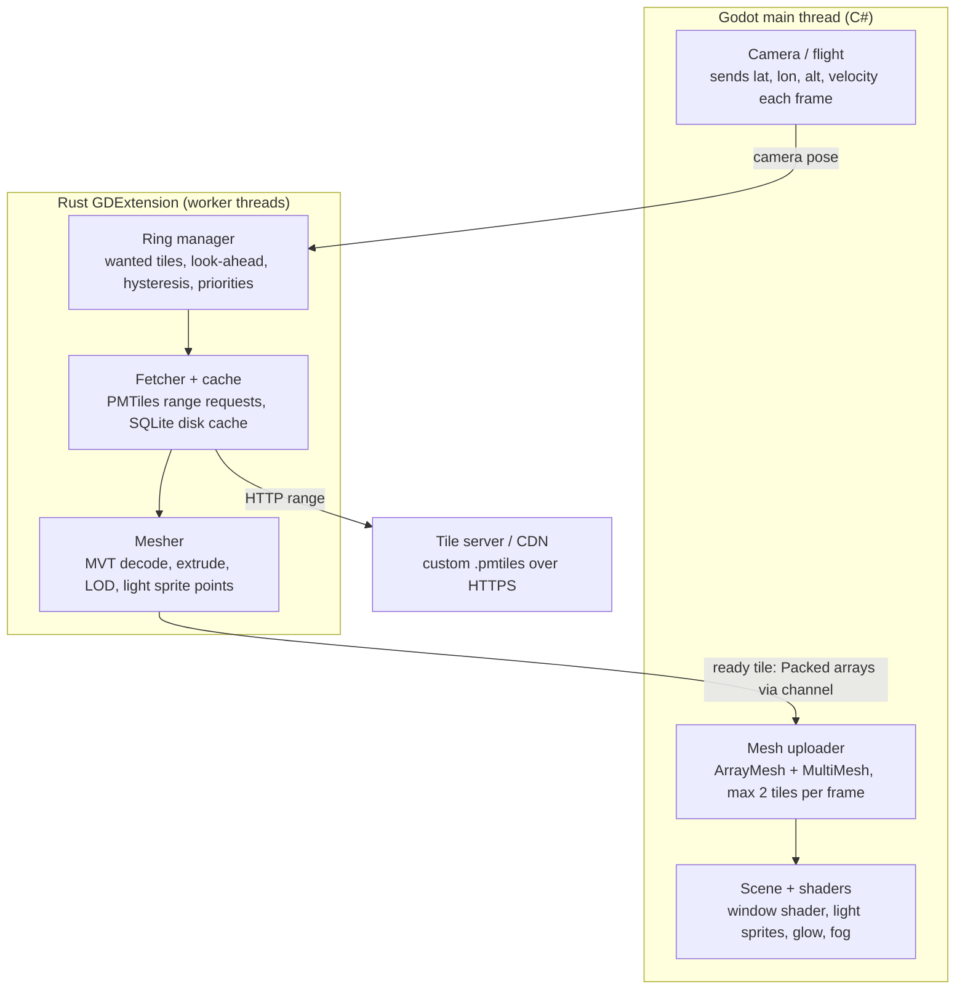

# Spike: Streamed OSM City with Night Lights

2026-10-26 · Aleksei

> Source: https://claude.ai/artifact/1Li6b4rWTHqGtKGDYQZE6E

## Goal and scope

The spike proves that a Rust GDExtension can stream real OSM buildings around a moving camera with procedural night lights, built and tested on desktop in Godot first. The iPhone 17 port follows once desktop meets the budgets. Test area: central Vilnius, about 10 × 10 km.

The GDExtension (`simplane_world`) is a **reusable library**: this spike is its first host, and the SimPlane game reuses it unchanged. Everything the game needs goes through the public `WorldStreamer` API (see "Library API"); nothing is specific to the spike scene.

**In scope**

- Tile rings around the camera, with load and unload while moving
- Low-poly building extrusion from OSM footprints, plus flat ground meshed from landuse, water and roads (roads do not glow; the `lit` flag is kept in the data for later street lamps and cars)
- Satellite imagery draped on the ground, from a configurable image source (see "Satellite imagery")
- Daylight: sun position and day/night factor from a clock, exposed to the host (see "Daylight")
- Night window lighting driven by building type
- Distant light sprites as GTA-style LOD lights
- Floating origin
- Desktop build of the Godot C# project with the Rust library, kept iOS-ready (rustls, no desktop-only crates)

**Out of scope (later spikes)**

- iOS export and on-device tuning (next step after desktop); DEM terrain and elevation (a terrain hook is built in, so it can be added without API changes)
- Moving cars and street lamps along roads
- Roofs other than flat
- Water and reflections
- Integration with JSBSim flight (the spike uses a free-fly camera with a speed slider up to 250 m/s)

## Architecture

Godot and C# own the camera, the scene and the shaders. Rust generates the whole world: fetching, decoding, building and terrain meshes, LOD and light points. The same crate runs on desktop now and on iOS later; Godot only displays what Rust hands it.

*Rust does the heavy work off the main thread; Godot only uploads meshes.*

- **Interface:** a `WorldStreamer` node registered by Rust, called from C# through `Call()`. `update_camera(local_pos, velocity, alt_agl)` runs each frame (local floating-origin coordinates; a geodetic variant is planned, see [contract.md](contract.md)); `poll_ready()` returns at most N finished tiles.
- **Threads:** a tokio runtime for I/O and a rayon pool for meshing. Results go back over a crossbeam channel. Rust never touches Godot nodes off the main thread.
- **Floating origin:** world position in f64 ENU inside Rust, f32 local to the origin in Godot. Re-center when the camera is more than 5 km from the origin; every tile root gets shifted in one frame.
- **Output per tile:** `PackedVector3Array` positions and normals, `PackedColorArray` for profile, seed and floors, `PackedInt32Array` indices, and a separate point list for light sprites. With imagery enabled, also the tile's ground texture as a Godot `Image` with mipmaps.

## Tile grid and 3D LOD

Tiles are fixed in Web Mercator (z/x/y); only the set of active tiles follows the camera. LOD is chosen by **3D slant distance** from the camera to each tile (horizontal distance and height together), not by ground distance. One rule then covers climbing: as the camera rises, every tile moves to a coarser band, buildings fade out, and at cruise only blurred city lights remain. There are no separate altitude rules.

At Vilnius latitude, a z16 tile is about 350 m wide and a z14 tile about 1.4 km.

| Band | Zoom | Slant distance | Content |
|------|------|----------------|---------|
| R0 | z16 | < 0.6 km | Full extrusion, window shader |
| R1 | z15 | 0.6–2.5 km | Boxes, merged per tile, window shader |
| R2 | z14 | 2.5–7 km | One merged mesh per tile, emissive per building, no windows |
| R3 | z13 | 7–25 km | Light sprites only, blurred |
| — | — | > 25 km | Nothing; fog and horizon glow (superseded: the terrain layer, `docs/spec-terrain.md`, reaches 130 km; with a world seed it carries land and sea, `docs/spec-world-seed.md` section 5.5) |

**What you see by altitude (above ground)**

| Altitude | Directly below | Toward the horizon |
|----------|----------------|--------------------|
| 300 m | R0 full buildings | R1 → R2 → lights |
| 1000 m | R1 boxes (no R0 possible: slant ≥ 1 km) | R2 → lights |
| 3000 m | R2 merged blocks | lights |
| 7000 m and up (cruise) | lights only | lights fading into fog |

**Rules**

1. **3D query:** slant distance `d = √(horizontal² + (cam_alt − ground)²)` to the nearest point of the tile's box (footprint × max building height). Candidate tiles lie within a horizontal radius `√(25 km² − h²)` of the look-ahead point; above 25 km nothing is requested.
2. **Look-ahead:** center = camera + velocity × 20 s, including vertical speed, clamped to half the band's radius. A climb drops fine tiles early; a descent requests them early.
3. **Priority:** finer band first, then by slant distance to the look-ahead point. At most 4 fetches and 2 mesh jobs run per band at a time.
4. **Hysteresis:** a tile changes band only once its slant distance is 15% past the band edge, so it doesn't flicker while circling or holding altitude.
5. **No holes:** a finer tile hides the coarser tile it covers only once it is ready. Until then, the coarser tile stays visible.
6. **Pooling:** reuse `MeshInstance3D` and `MultiMeshInstance3D` nodes from a pool; don't free and reallocate them.

## Data pipeline

You need your own tiles, because standard schemas such as OpenMapTiles drop building type. The build is one offline job; the app only does HTTPS range reads.

1. **Source:** a Geofabrik extract for Lithuania (`.osm.pbf`).
2. **Build:** planetiler (or tilemaker) with a custom profile writing one `.pmtiles` file for z13–z16.
3. **Host:** any static host or CDN that supports HTTP range requests (S3 + CloudFront, Cloudflare R2). Never public OSM tile servers.
4. **Fetch in Rust:** the `pmtiles` crate with a `reqwest` + rustls backend. The header and directories are cached once, then each tile is one range request.
5. **Cache:** raw MVT bytes in one SQLite file per source (`tiles-{hash}.sqlite`, WAL, own cache thread) in the app's Caches directory, LRU by bytes with a cap of 300 MB (profile key `cache.cap_mb`); built and measured, see [spec-tile-cache.md](spec-tile-cache.md). Pre-download the test area before a flight in later versions (`simworld-cli bake`).

**Layer `buildings` (custom profile)**

| Field | From OSM | Fallback |
|-------|----------|----------|
| `id` | way/relation id | — |
| `height` (m) | `height` | `levels × 3.0` |
| `levels` | `building:levels` | by landuse: residential 5, commercial 4, industrial 1, else 2 |
| `kind` | `building` | `landuse` of the containing polygon |
| `min_height` | `min_height` | 0 |
| `colour` | `building:colour` | palette by kind |

Also export a `roads` layer with `highway` and `lit`, so the lamps and cars spike can reuse the same tiles. Attribution required: "© OpenStreetMap contributors" (ODbL).

The `landuse` layer also carries parks and green areas (`leisure=park`, `landuse=grass/forest`, `natural=wood`) and water (`natural=water`, riverbanks), so the ground mesh can color them. Its `kind` is the most specific of `landuse`, `leisure` and `natural`.

## Building generation and light profiles

Each building becomes a flat-roofed prism in Rust. Its light behavior is encoded per vertex, so one shader lights the whole city.

**Mesher steps (per tile, on a rayon thread)**

1. Decode the MVT layer (`mvt-reader` or `geozero`) and convert tile coordinates to local meters.
2. Simplify the footprint: Douglas–Peucker at 0.5 m (R0) or 2 m (R1); drop footprints under 20 m² at R1 and up.
3. Walls: one quad per edge, with flat normals and UV.x = meters along the perimeter, UV.y = meters up. The window shader needs real meters.
4. Roof: `earcutr` triangulation (R0 only; R1 uses the same).
5. Merge all buildings in the tile into one vertex buffer, so it's one draw call per tile.
6. Light points: one point per building at its centroid and roof height, for the R2/R3 sprites.

**Per-vertex data (COLOR channel)**: `r` = profile id / 8, `g` = seed (hash of the OSM id), `b` = floor height, `a` = building height. The seed keeps the same windows lit every time you return.

**Light profiles**

| Profile | OSM `kind` | Window color | Lit share 18–22 h | Lit share 0–5 h |
|---------|------------|--------------|-------------------|-----------------|
| Residential | residential, apartments, house | warm 2700 K | 45% | 8% |
| Office | office, commercial | cool 4500 K | 70% until 20 h, then 15% | 5% |
| Retail | retail, supermarket | bright white, ground floor only | 90% until 21 h | 10% |
| Industrial | industrial, warehouse | sodium orange, wall lamps only | 5% | 5% |
| Civic / landmark | church, government, university | floodlit facade gradient | — | — |
| Unknown | yes | as its landuse, else residential | — | — |

The percentages are starting values to tune by eye; they are not measured data.

## Ground and terrain hook

The ground stays flat for this spike, but it is no longer a blank plane: Rust meshes each tile's landuse, water and road polygons into one flat ground mesh, so parks, rivers and streets read from the air.

- **Areas:** landuse, park and water polygons triangulated with `earcutr` at ground height, with a small offset per class to avoid z-fighting (water lowest); color per class from a fixed low-poly palette.
- **Roads:** `roads` lines buffered into flat strips laid just above the areas; width by `highway` class: motorway 14 m, primary 10 m, secondary 8 m, tertiary and residential 6 m, other 3 m.
- **Night:** roads stay dark asphalt (decision 2026-10-27: roads do not glow). Strips with `lit=yes` keep the `lit` flag in the vertex COLOR for later street lamps and car headlights.
- **Bands:** ground for R0–R2 (z16–z14), simplified more at coarser bands; R3 has lights only (with imagery on, R3 also gets one textured quad, see "Satellite imagery"). One ground mesh per tile with its own material, following the same visibility rule as the buildings. It adds one draw call per R0–R2 tile, counted against the 300 cap.
- **Terrain hook:** every height goes through one Rust elevation function, `ground_height(lat, lon)` in meters, which returns 0 for now. Building bases, ground vertices and the slant-distance query use it, and `WorldStreamer.ground_height_at(local_x, local_z)` exposes it to Godot for height above ground. A later DEM spike swaps the function's source without changing the API.

## Satellite imagery

Imagery replaces the flat class colors of the ground in daylight. It is optional: with no image source configured, the ground keeps the class palette from "Ground and terrain hook".

**Image source (configurable, never hard-coded)**

- The host passes one or more sources to `configure_imagery`. Each source has a URL, a zoom range and an attribution string, so a coarse source can serve the outer bands and a fine one the near bands (e.g. a 10 m/px satellite mosaic for R2/R3, an aerial orthophoto for R0/R1).
- Supported URL forms: a raster `.pmtiles` archive (preferred; same range-request path as the vector tiles) or an XYZ template `https://host/{z}/{x}/{y}.jpg`. Formats: JPEG, PNG, WebP.
- Self-hosted only, like the vector tiles. The source's license must allow caching on the device and serving from our own host; many commercial imagery APIs forbid both. Attribution is shown on screen whenever imagery is visible.
- Preferred build: an offline job cuts the imagery into a raster `.pmtiles` aligned with our tile grid, one image per streamed tile per band, so each tile costs one range request.

**Resolution per band**

| Band | Tile | Texture | Ground resolution (Vilnius) |
|------|------|---------|-----------------------------|
| R0 | z16, ~350 m | 1024 px | ~0.35 m/px |
| R1 | z15, ~700 m | 512 px | ~1.4 m/px |
| R2 | z14, ~1.4 km | 512 px | ~2.7 m/px |
| R3 | z13, ~2.8 km | 256 px | ~11 m/px |

If a source has no image at the needed zoom, Rust builds the texture from the nearest coarser zoom it has (cropped and upscaled), so a tile never waits on imagery that does not exist.

**Pipeline**

1. Fetch: on the tokio runtime, in parallel with the vector tile; its own byte cap (default 500 MB, set by `cache_mb`), planned as a second table in the same SQLite file (spec-tile-cache.md, "Later"), keyed by source fingerprint so a rebuilt archive never serves stale images.
2. Decode on a rayon thread to RGBA8, build mipmaps, and darken nothing: day/night shading happens in the shader.
3. Ground UVs: Rust writes `TEX_UV` on every ground vertex as the vertex position in the tile, 0..1 in Web Mercator x/y, so the texture lines up exactly with the vector geometry and with neighbouring tiles.
4. R3 gets a ground mesh when imagery is on: one textured quad per tile (2 triangles), so daytime flight at altitude shows the land, not the scene's fallback plane.
5. Main thread (`poll_ready`): wrap the pixels in a Godot `Image`; C# copies it into the tile's pooled `ImageTexture` (`Update` when the size matches, no reallocation).

**Delivery rules**

- Imagery travels in the same ready-tile dictionary as the meshes, so the sibling-swap visibility rule covers it with no extra logic.
- A tile is delivered once its vector data is meshed and its image is ready, or after an imagery timeout (default 3 s). On timeout or error, it goes out with no image (class colors) and is re-delivered under the same key when the image arrives, rate-limited like light-mode re-deliveries.
- Changing the source at runtime re-delivers every held ground tile in the same way.

**Shading**

- Day: ground albedo = imagery. Vector water polygons stay on top, so later reflections can use them. Road strips are not drawn over imagery by day, since roads are already in the photo.
- Night: imagery albedo is scaled by `1 − night_factor` toward a dark floor, and roads stay unlit.
- Buildings stand on the imagery as they are; the roof outlines and shadows baked into the photo are accepted for the spike.

**Rendering cost**

- One `ShaderMaterial` per pooled tile node (a texture cannot be an instance uniform), pooled with the node; the draw-call count does not change, since every tile already draws its own ground.
- GPU memory, uncompressed RGBA8 with mipmaps, rough estimate for a settled cover at 300 m AGL: R0 ~20 × 5.6 MB, R1 ~30 × 1.4 MB, R2 ~40 × 1.4 MB, R3 ~100 × 0.35 MB, about 250 MB in total. Compressed GPU formats (ASTC on iOS, BCn on desktop) cut this about 4×; the format is decided before the iOS port.

## Daylight

The library computes daylight, so the spike and the game share one answer for where the sun is and how dark it is.

- `set_clock(unix_utc, utc_offset_hours)` sets simulated time; the host advances it (real time, or a time-of-day slider in the spike).
- `daylight()` returns, for the current camera position: `sun_dir` (Vector3 toward the sun, in Godot local axes), `sun_elevation_deg`, `night_factor` (0 day … 1 night, smooth between sun elevation +6° and −6°, i.e. through civil twilight) and `local_hour` (0–24, used by the window `lit_share`).
- Solar position comes from a standard low-precision solar algorithm (accurate to well under 1°), computed in Rust from the camera's lat/lon; no network, no tables.
- Godot applies it: the `TimeOfDay` node points the `DirectionalLight3D` along `sun_dir`, drives the sky, and sets the shader globals `night_factor` and `hour` read by the window, sprite and ground shaders.

## Library API

`WorldStreamer` is the whole public surface of the library. The full contract (methods, call order, ready-tile dictionary, visibility rule, fades, color encodings, lights, coordinates, each with the `api_version` that introduced it) lives in [contract.md](contract.md); this section no longer repeats it. The host reads `api_version()` once on attach and logs a mismatch instead of probing silently.

Design intent behind the surface (not contract text):

- Configuration: world origin and vector tile source (`configure`), later image sources (`configure_imagery`: `url`, `min_zoom`, `max_zoom`, `attribution`, plus `cache_mb`, `timeout_s`; an empty array turns imagery off).
- Per frame: `update_camera`, then `poll_ready` / `poll_unload` (ready dictionaries gain `ground` and, with imagery, `imagery`), `take_origin_shift` for the floating origin, `ground_height_at` as the terrain hook (0 until a DEM spike).
- Daylight: `set_clock` / `daylight()` as described above. `attributions()` returns the strings currently required on screen (OSM, plus each active image source).
- Overlay: `debug_stats()` / `debug_tiles()`.

Note: the imagery, clock and daylight entries above are planned API (milestones M7+); check contract.md for what exists today.

The library has no knowledge of the spike scene: cameras, UI, materials and the time slider live in the host. Contract changes are additive where possible, `api_version` is the contract version, and `debug_stats()["version"]` is a display string that identifies the build.

## Rendering

Night looks come from emission, sprites and glow, not real lights: per GTA V, every distant light is a small textured quad, batched into instanced geometry ([source](https://www.adriancourreges.com/blog/2015/11/02/gta-v-graphics-study-part-2/)).

**Window shader (one `ShaderMaterial` for all building tiles)**

- Cell = floor height × 3 m, from UV in meters; a window rect inside each cell, the frame left dark.
- `lit = hash(seed, floor, column) < lit_share(profile, time_of_day)`; color from the profile; slight per-window brightness jitter.
- Ground floor of Retail uses its own share; Civic uses a vertical gradient instead of windows.
- Daytime: same shader, emission 0, window cells darker and slightly reflective.
- Beyond ~3 km, fade the window grid into an average emission, to avoid shimmering.

**Light sprites (R2/R3)**

- One `MultiMeshInstance3D` per tile, a billboard quad with a 32×32 radial texture, additive blend, no depth write.
- Lights blur with slant distance: 2–4 px and sharp up to ~7 km; beyond that, a softer falloff and 6–12 px. Above ~3000 m, Rust clusters a tile's lights into 100 m cells (summed color and count), so cruise shows a soft glowing carpet instead of thousands of dots.
- Cross-fade with R1 windows over ~300 m so there is no pop.

**Post and atmosphere (Godot Mobile renderer)**

- `WorldEnvironment` glow at half resolution, 2–3 levels, threshold just below window emission.
- Depth fog plus height fog for the "blur" of distance; glow strength rises with altitude so the light carpet blooms at cruise; no depth-of-field pass.
- A single `DirectionalLight3D` (sun by day, moon by night) driven by `daylight()`, with shadows off at night.

The night-specific rendering techniques (dithered LOD fades, bloom threshold, tone mapping, exposure, depth precision) are specified in `docs/spec-night-rendering.md`.

## iOS and iPhone 17 constraints (after desktop)

The riskiest part is the toolchain, not the rendering: Godot's C# on iOS is experimental and builds through .NET NativeAOT ([source](https://remotebranch.eu/Stowage/godot/commit/ee9a735c2649e10123bfbfded96bbc4cc68428f5)). Desktop comes first, but avoid anything that blocks the port, and prove the iOS export before tuning for the phone.

- **Rust build:** targets `aarch64-apple-ios` and `aarch64-apple-ios-sim`, packaged as a static `.xcframework` and referenced from the `.gdextension` file. Godot fixed loading static libraries and xcframeworks for GDExtension on iOS ([source](https://remotebranch.eu/Stowage/godot/commit/d4d5d68edaf9bb8f2f62b9938b21df9fd3ab3336)).
- **Simulator:** it only supports the Compatibility renderer, so test performance on the real device ([source](https://docs.godotengine.org/ko/4.x/_sources/engine_details/development/compiling/compiling_for_ios.rst.txt)).
- **Network:** HTTPS only (App Transport Security); rustls avoids linking OpenSSL.

**Budgets (targets for the spike)**

| Budget | Target |
|--------|--------|
| Frame rate | 30 fps sustained over 15 min, no thermal throttle warning |
| Main-thread upload | ≤ 2 ms per frame |
| Draw calls | ≤ 300 |
| Triangles on screen | ≤ 1.5 M |
| RAM (whole app) | ≤ 1.2 GB |
| Disk cache | ≤ 300 MB vector + ≤ 500 MB imagery |
| Data per km flown at 300 m AGL | ≤ 2 MB vector; imagery ≤ 6 MB (estimate, to measure) |
| Imagery GPU memory | ≤ 256 MB uncompressed on desktop; ≤ 96 MB compressed on iOS |
| Imagery upload | Counts against the 2 ms main-thread upload budget; R0 textures may need their own frame |

## Milestones, acceptance and risks

The milestones run in order; each ends with a demo on the device.

1. **Toolchain:** a Godot C# scene plus a Rust "hello" node runs on desktop, with the Rust library rebuilt and reloaded from the editor.
2. **Tiles:** the custom `.pmtiles` for Vilnius is hosted; Rust fetches and caches tiles; a debug overlay shows the rings.
3. **Buildings:** R0 and R1 extruded buildings stream around a free-fly camera with floating origin.
4. **LOD:** R2 merged meshes and R3 sprites, with look-ahead, hysteresis and altitude rules.
5. **Ground:** flat landuse, water, park and road meshes per tile, roads unlit, and the `ground_height` terrain hook (returns 0 for now).
6. **Night:** window shader, profiles, sprite cross-fade, glow and fog (details in `docs/spec-night-rendering.md`); `set_clock` / `daylight()` in Rust and a time-of-day slider that drives sun, sky and shader globals from it.
7. **Imagery:** `configure_imagery` with a self-hosted raster source, imagery cache, ground `TEX_UV`, per-tile textures from the pool, R3 textured ground, day/night shading, on-screen attributions.
8. **Measure:** desktop frame time and memory in a recorded 15-minute flight, then port to iPhone 17 and check the iOS budgets.

**Acceptance criteria**

- [ ] Flying at 250 m/s and 300 m AGL over Vilnius shows no holes and no tile popping inside R0.
- [ ] Desktop holds 60 fps within the iOS caps for draw calls, triangles and RAM, so the port has headroom.
- [ ] Returning to a place shows identical buildings and lit windows.
- [ ] Offline after one pass: cached area renders with no network.
- [ ] At night, building types are distinguishable from 1000 m.

**Risks**

| Risk | Impact | Fallback |
|------|--------|----------|
| C# export to iOS fails or is unstable | Blocks the whole sim on iOS | Move the main loop into Rust or GDScript; C# stays on desktop |
| Streaming can't keep up at 250 m/s | Holes near the camera | Longer look-ahead, coarser R0 above 500 m, prefetch along the route |
| Missing OSM levels/types | Flat, uniform city | Landuse fallbacks, seeded random levels |
| Thermal throttling | Frame drops after minutes | Lower glow levels, 30 fps cap, smaller R1 |
| Tile hosting cost | Bills grow with players | CDN caching, regional files, preloaded routes |
| Imagery license forbids caching or rehosting | No usable high-res source | Open satellite mosaic for R2/R3 only, class colors near the camera |
| Imagery memory or upload too heavy on iPhone | Frame drops, memory warnings | Compressed GPU formats, smaller R0 textures, imagery only up to R1 |

**Open questions**

- Which Godot 4.x version and .NET version will the project pin?
- Do you own or rent the tile host for the spike?
- Which imagery source(s) for Vilnius, and does the license allow on-device caching and self-hosting? (Candidates: the national aerial orthophoto for R0/R1, an open Sentinel-2 mosaic for R2/R3; licenses to check.)
- Imagery GPU format for iOS: ASTC transcoded in Rust from JPEG/WebP, or pre-compressed KTX2/Basis in the archive?

## Sources

- [GTA V Graphics Study, Part 2](https://www.adriancourreges.com/blog/2015/11/02/gta-v-graphics-study-part-2/)
- [Godot commit: C# iOS support](https://remotebranch.eu/Stowage/godot/commit/ee9a735c2649e10123bfbfded96bbc4cc68428f5)
- [Godot commit: iOS GDExtension static libraries](https://remotebranch.eu/Stowage/godot/commit/d4d5d68edaf9bb8f2f62b9938b21df9fd3ab3336)
- [Godot docs: Compiling for iOS](https://docs.godotengine.org/ko/4.x/_sources/engine_details/development/compiling/compiling_for_ios.rst.txt)
